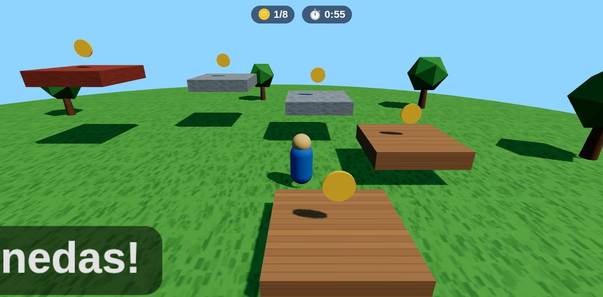
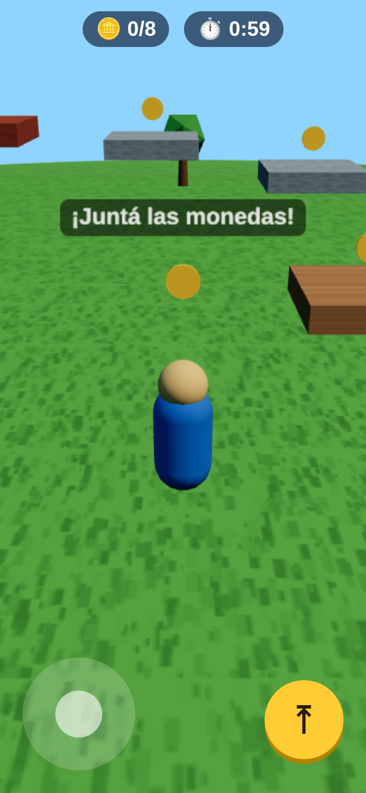

# juegos-3d

Una skill para **crear y diseñar juegos 3D para el navegador** con Claude (o cualquier agente que lea skills).

El juego sale en **un solo archivo HTML**, sin nada que descargar. Se publica como Artifact de Claude, se abre con
doble clic o se manda por WhatsApp. Se juega con teclado o en el celular.

<p align="center">
  
  
</p>

Salió de construir **Mundo Catrucho**, un juego 3D de Honduras con 18 departamentos y sus minijuegos.

## Qué trae

- **Un método:** diseñar primero, arrancar de una plantilla que ya funciona, construir con un kit de piezas, probar,
  **mirar las capturas**, publicar e iterar.
- **Una plantilla jugable** (`plantilla/`): React Three Fiber, física ligera hecha a mano, jugador en tercera
  persona, materiales pintados en lienzo, texto 3D sin fuentes externas, controles de teclado y táctiles, menú, HUD,
  victoria y derrota.
- **Un arnés de pruebas** que abre el juego en Chromium sin ventana y lo juega solo: camina, salta, toma monedas,
  gana, pierde, prueba en tamaño de celular, mide el rendimiento, revisa que no haya red, y toma capturas y video.
- **Referencias** de diseño (bucle principal, etapas, motores y temas), del kit y el rendimiento, y de las pruebas y
  CI.

## Instalar

```bash
git clone https://github.com/luiscf1226/juegos-3d ~/.claude/skills/juegos-3d
```

O en `~/.agents/skills/juegos-3d`, o `npx skills add luiscf1226/juegos-3d`. Necesitas Node 22 o más, `pnpm` o
`npm`, y Chromium o Chrome para las pruebas. `ffmpeg` solo hace falta para el video.

## Usar

Pídele a Claude cosas como:

- «Hazme un juego 3D de recoger mangos en una finca.»
- «Diseña un minijuego de carreras en lancha y publícalo como artifact.»
- «Está muy difícil la etapa 1 y la cámara marea.»

También puedes usar la plantilla a mano:

```bash
cp -r ~/.claude/skills/juegos-3d/plantilla mi-juego && cd mi-juego
pnpm install
pnpm dev         # para jugar mientras construyes
pnpm test        # juega solo y tiene que imprimir PASA
pnpm capturas    # capturas/*.png y recorrido.mp4
pnpm build       # dist/juego.html y dist/artifact.html
```

## Licencia

MIT
